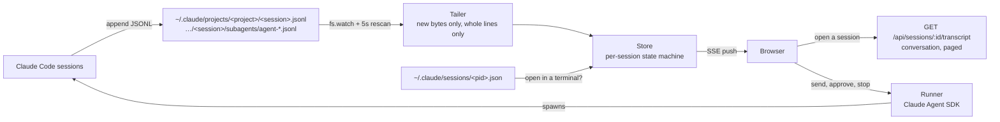

# Claude Code Console

A local web console that watches every Claude Code session on your machine and organises them by folder. Each folder is a **personal assistant (PA)**, and the console tells you at a glance:

- **which sessions need you**: finished and waiting, asking a question, or hitting API errors, in one queue across every PA
- **what the others are doing**: the tool running right now, its target, how long it's been running, and live subagents
- **what it all costs**: today, over the last week, per PA, per session and per model

You can also **talk to sessions from the browser**: resume one, start a new one in any PA, approve or deny tool calls, answer Claude's questions, review plans, and stop a turn. Each PA can set a default model and permission mode for the sessions the console starts there.

Codex CLI sessions show up too, alongside Claude Code's (see [Codex CLI sessions](#codex-cli-sessions)).

It has three screens, with a sidebar listing your PAs:

| Screen | Shows |
|---|---|
| **Overview** | The needs-you queue, today's and this week's spend, and a card per PA |
| **PA** | That folder's sessions, grouped into needs you / working / recent |
| **Session** | The full conversation and a message box, plus a Details tab with cost, context, subagents, files and the activity log |

A PA is the git repo a session ran in, so sessions started in `repo/` and `repo/src`, or in a worktree, land together. Folders outside a repo are their own PA. You can rename, pin and hide PAs, and add a folder that has no sessions yet. Those choices are saved in `~/.claude-code-console/config.json`.

It runs entirely on your machine and reads the transcripts Claude Code already writes. It needs Node.js 20+. Its only dependency is the Claude Agent SDK, which is used for chat. Chat uses the same login and settings as your `claude` command, so set that up first.

Light and dark themes are included. It follows your OS setting until you pick one with the ☀/☾ button.

```bash
npx github:yuxiaojian/claude-code-console
# or
git clone https://github.com/yuxiaojian/claude-code-console && cd claude-code-console && npm install && npm start
```

Then open the link it prints, `http://localhost:3001/?token=…`. The browser remembers the token, so you only need the link once. The token is kept in `~/.claude-code-console/token`; delete that file to issue a new one.

```
Options:
  -p, --port <n>   Port to listen on (default 3001, or $PORT)
      --host <h>   Interface to bind (default 127.0.0.1)
  -d, --days <n>   Load sessions active in the last n days (default 7)
      --dir <path> Transcript directory (default ~/.claude/projects, honours $CLAUDE_CONFIG_DIR)
      --codex-dir <path>
                   Codex CLI sessions (default ~/.codex/sessions, honours $CODEX_HOME)
      --config <f> Where PA names, pins, defaults and added folders are saved
                   (default ~/.claude-code-console/config.json; the access
                   token is kept next to it)
```

## How it works



**Watching.** `src/watcher.js` uses a recursive `fs.watch` for low latency and runs a stat-based rescan every 5 seconds in case events are dropped. On startup it only reads files modified within `--days`, oldest-created first.

**Tailing.** `src/tailer.js` remembers a byte offset per file and reads only what has been appended since. An incomplete last line (Claude Code mid-write) is held back until its newline arrives. Reads of the same file are serialised, so overlapping change events can't read the same bytes twice.

**State.** `src/store.js` folds each transcript event into per-session state. Status is driven by the transcript itself, not by guessing from elapsed time:

| Transcript signal | Status |
|---|---|
| user prompt, `tool_result`, streaming assistant blocks | **thinking** |
| assistant `tool_use` with no result yet | **running tool** (name, target, elapsed) |
| pending `AskUserQuestion` / `ExitPlanMode` | **needs answer** |
| an approval waiting in the console, or a terminal process reporting `waiting` on a tool call | **needs approval** |
| `stop_reason: end_turn`, `system/turn_duration`, interrupt, local command output | **waiting for you** |
| `system/api_error`, synthetic API-error message | **error** (with cause and retry count) |
| `cost-state` (Claude Code writes it on exit) | **ended** |
| thinking/tool with no events for 10 min | **no activity** (stale) |

**Subagents** come from `subagents/agent-<id>.jsonl` and their `.meta.json`, which provides the agent type, description and the parent's `toolUseId`. A subagent is marked done when the parent receives the `tool_result` for the Agent call that spawned it, so finished subagents never get stuck as "running". Subagent spend counts toward the session's cost but not toward its context window.

**Cost.**
- A streamed message is written as several lines, each repeating that message's running usage, so only the change from the previous line is added.
- The estimate uses list prices from `src/pricing.js` per model:
  - Cache writes are billed at 1.25× input (5-minute TTL) or 2× input (1-hour TTL).
  - Cache reads have their own rate for each model.
- When Claude Code has written a `cost-state` (cumulative across resumes), the console shows **that figure plus any spend estimated since**. That figure also includes calls that never reach the transcript, such as title generation and auto-mode classifiers, which is why a pure transcript estimate typically comes in around 10% low.
- **Today** and **last 7 days** totals add up the estimate for each API call on the day it was made, so they run slightly below the per-session figures.
- Costs are first-party list prices. Bedrock and Vertex bill differently.

**Conversation.** `src/transcript.js` reads a session's transcript the first time you open it and then only what has been appended since. A few transcripts are cached. It keeps a trimmed copy of each item:
- Long tool output keeps its start and end.
- Edits keep the diff Claude Code recorded (`structuredPatch`), or one built from the edit itself.
- File contents and images stay on disk.

That turns an 89 MB transcript into about 0.6 MB, parsed in roughly 100 ms. The UI loads the newest 150 items, pages back on request, and re-reads the last few items as the session runs, so tool results land on the calls already shown. Replies are rendered by a small Markdown renderer (`public/markdown.js`) that builds DOM nodes directly and only allows `http`, `https` and `mailto` links. LaTeX math is shown as written.

**Chat.** `src/runner.js` runs Claude Code through the [Claude Agent SDK](https://www.npmjs.com/package/@anthropic-ai/claude-agent-sdk), one process per session in streaming-input mode, so follow-up messages go to the same process.
- **Settings:** it loads your settings and `CLAUDE.md` the way the terminal does, so it uses the same account (including Bedrock or Vertex) and permission rules.
- **Approvals:** it starts in `default` permission mode, so anything your rules don't already allow comes to the browser as an approval card. "Always allow" applies Claude Code's own suggestion, scoped to that session.
- **Processes:** a process the console started closes after 10 minutes idle, or when you click Disconnect. Claude Code writes the transcript as usual, so the conversation view shows everything it does.
- **Without the SDK:** if it isn't installed, the console still works, read-only.

**Defaults per PA.** A PA's ⚙ Defaults panel sets the model and the permission mode used whenever the console starts, resumes or forks a session in that folder.
- **Model:** the choices are Claude Code's own aliases (`opus`, `sonnet`, `haiku`), so they resolve the way your setup does, plus any model the PA's sessions have used.
- **Permission mode:** ask before tools (the default), accept edits, plan only, or auto. `bypassPermissions` is never offered.
- **Message box:** it has its own mode picker. Changing it on a running session switches that session's mode right away.
- **Terminal sessions:** these keep whatever their own settings say.

**Forks.** Forking copies a session's history into a new session, keeping each line's id but not recording where it came from. The console remembers which session wrote each line first, so it can tell the copy apart:
- **Linking:** it links the fork and the original both ways.
- **Counting:** it counts the copied part once, under the original, so spend and turns aren't doubled.

For this to work, transcripts are read oldest-created first. A fork whose original is outside the loaded window counts the copied history as its own.

**Notifications.** With 🔔 on, the console notifies you when a session in a background tab starts needing you. That covers a turn finishing, an error, or a question. Approval requests notify even mid-turn, say what Claude wants to do, and stay up until you act, since Claude is blocked until then. Clicking a notification opens the session.

**Open in a terminal.** Claude Code records every running process in `~/.claude/sessions/<pid>.json`. If a session's process is alive and isn't one the console started, the session is marked *in terminal* and the console won't send to it, since two writers would interleave one transcript. Instead you can **fork** it: Claude Code copies the history into a new session that the console runs. A terminal process that reports `waiting` while it's on a tool call is shown as **needs approval**.

**Context** is the total tokens in the main thread's last request, measured against the model's context window. A compaction resets it to the post-compaction size.

## Codex CLI sessions

If the [Codex CLI](https://developers.openai.com/codex) is installed, its sessions show up next to Claude Code's, in the same PAs, marked **Codex**. Desktop-app, IDE and cloud sessions are not included.

**What's shown.** The console reads the rollouts Codex writes under `~/.codex/sessions/` (`src/codex/store.js`). It shows sessions started by the Codex TUI (`codex`), by `codex exec`, or by the console itself. Status, current tool, prompts, subagents, tokens and context come from the rollout. A Codex TUI opened and closed without a prompt is skipped.

**Talking to Codex.** The console runs `codex app-server`, one process per session, through `src/codex/runner.js`. It uses your Codex login and `config.toml`. Codex 0.164.0 is the version tested; with an older or newer version that isn't tested, Codex history still shows, but chat for Codex is off.
- **New sessions:** pick Claude Code or Codex in the New session pane.
- **Continuing:** only a Codex session the console is running right now can be continued. Every other Codex session can be **forked**: earlier sessions, ones open in a Codex terminal, and ones the console ran before it restarted. Codex keeps forks as a reference to the parent's history, so forking doesn't duplicate anything. Disconnect and Stop only ever end or interrupt the console's own Codex process.
- **Approvals and questions:** these come from Codex itself, and each card offers exactly the choices Codex offers. A choice that saves a rule for future sessions says *saved to your Codex rules*. Questions can have secret answers, which are typed into a password field and only sent to Codex. MCP servers that ask for form input can only be declined or cancelled from the console.
- **Policy:** each Codex session gets one of three native presets, shown as Codex's own approval policy and sandbox:

  | Preset | Approval | Sandbox |
  |---|---|---|
  | default | `on-request` | `workspace-write` |
  | read only | `on-request` | `read-only` |
  | untrusted | `untrusted` | `workspace-write` |

  Workspace writes may run without asking, and your Codex rules and managed settings still apply. Full access is never offered. A change made in the message box applies from the next message. Model and everything else come from your Codex configuration, unless the PA's ⚙ Defaults set a Codex model. Codex defaults are kept separately from Claude's.

**Open elsewhere.** Codex holds a writer lock per session in `~/.codex/thread-writer-locks/`. Lock files outlive their holders, so the console asks `lsof` which process actually holds one (`src/codex/live.js`).
- A session another process holds is marked *open elsewhere*. The Codex TUI's background daemon keeps holding a session after its window closes.
- If `lsof` can't tell, the session is marked *may be open elsewhere*.
- Either way it is only displayed: Codex sessions are never continued, only forked.

**Cost.** Codex usage is counted from the token record Codex writes for each model response.
- **Deduplication:** a record counts once, by response id. It only counts in the file of the session it names. Records that can't be attributed are skipped, and the session says so.
- **Unknown prices:** the console has no list prices for Codex models, so their dollar figure is *unknown* and token counts are shown instead. Totals that include unpriced or skipped usage are marked **+?**, so they never look complete when they aren't. Dollar figures are API-equivalent estimates, not what a ChatGPT plan bills.

**Errors.** Codex's own error text can contain keys and paths. The browser gets fixed messages such as "not logged in" or "open in another Codex process". The one exception is a failed turn's reason (a rate limit, say), which is shown with anything that looks like a credential or a path removed.

**Verified against Codex CLI 0.164.0.**
- Exercised live: rollout format and token records, `thread/start`, `thread/fork` (including forking a session another process holds), `turn/start`, `turn/interrupt`, command approvals, `serverRequest/resolved` and writer-lock conflicts.
- Built from the 0.164.0 protocol schema and fixtures, not exercised live: file-change and permission approvals, questions, MCP elicitation, `turn/steer`, subagent rollouts and compaction events. Unknown shapes are ignored or refused, never guessed at.

## Security

Transcripts contain your prompts, code and file paths, and the console can run Claude Code, so:

- Every API call needs the access token. The startup link carries it once; after that it's an `HttpOnly`, `SameSite=Strict` cookie. Static files (HTML, CSS, JS) hold no data and are served without it.
- The server binds to `127.0.0.1` by default and rejects requests whose `Host` header isn't localhost, which blocks DNS rebinding.
- Every request that changes something (sending, approving, renaming, opening a folder…) must carry a custom header, which other websites can't send. When the browser includes an `Origin`, it must be the console's own.
- "Open folder" takes a session or PA id, not a path, and only opens that folder.
- All transcript text is rendered with `textContent`, never as HTML.
- Binding to another interface with `--host` prints a warning: the token still applies, but traffic isn't encrypted.
- Sessions started from the console ask before running tools unless your own permission rules already allow them.
- Codex routes go through the same checks. Codex's stderr is discarded, and its error text reaches the browser only as fixed messages or redacted.

## Development

```bash
npm test          # node:test; chat is tested against a fake SDK
npm start -- -d 7
```

| File | Role |
|---|---|
| `src/cli.js` | argument parsing, wiring, startup |
| `src/watcher.js` | finding and watching transcript files |
| `src/tailer.js` | incremental, line-safe file reading |
| `src/store.js` | event → session state, status, cost, subagents |
| `src/pricing.js` | model prices and context windows |
| `src/projects.js` | grouping sessions into PAs, saved PA settings |
| `src/transcript.js` | transcript → conversation items, incremental and cached |
| `src/runner.js` | running sessions through the Agent SDK, approvals |
| `src/live.js` | which sessions are open in a terminal |
| `src/server.js` | HTTP API, SSE stream, static files; sessions are addressed as `claude:<id>` / `codex:<id>` (a bare id means Claude) |
| `src/codex/store.js` | Codex rollout → session state, CLI filter, usage attribution, fork ancestry |
| `src/codex/transcript.js` | Codex rollout → conversation items, including a fork's inherited history |
| `src/codex/runner.js` | running Codex sessions through `codex app-server`, native approvals and policy presets |
| `src/codex/live.js` | which Codex sessions another process holds (display only) |
| `src/codex/errors.js` | safe error messages and redaction |
| `public/` | the UI (vanilla JS modules, no build step): `app.js` shell and sidebar, `overview.js`, `pa.js`, `session.js`, `conversation.js`, `chat.js` message box and approvals, `codex-cards.js` Codex approval and question cards, `markdown.js`, `core.js` shared helpers |

Transcript formats aren't a public API, so if a Claude Code update changes them, start by looking at `Store.ingest`.

Inspired by [claude-code-dashboard](https://github.com/Stargx/claude-code-dashboard); this is a from-scratch rewrite.

## License

[MIT](LICENSE)
